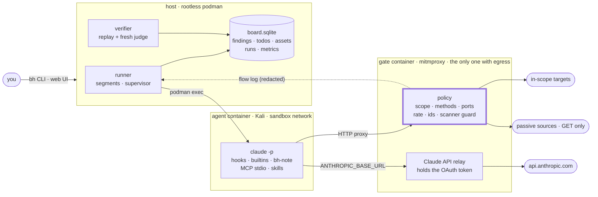
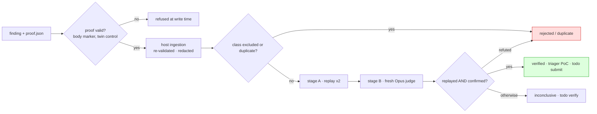

# bull-harness

An autonomous bug bounty harness. A Claude Code agent hunts from a Kali sandbox whose **only**
network path is a gate that enforces the program's scope and rules. The host keeps the state
and checks every finding independently. A human keeps the decisions: program rules, triage and
submission.



More diagrams are in [`docs/diagrams.md`](docs/diagrams.md): one segment step by step, the gate's
decision for one request, the life of a finding, the path from YesWeHack rules to enforcement, and
the module map.

## What keeps the agent honest

| Concern | Where it is enforced | How |
|---|---|---|
| Scope | gate | `bh.scope.check()` on the hostname the client asked for. The pinned IP is mapped back to the name it was vetted for, and the Host header is checked too. Out-of-scope requests get a `403 X-BH-Gate`. |
| Network escape | containers | The agent sits on an internal network. It has no DNS and no route out except the gate. Raw TCP and websockets are refused. |
| Writes | gate | PUT, PATCH and DELETE (method overrides included) go through only as one of *your* identities, and that identity's file must exist. |
| Program rules | gate + host | Rate limit with backoff on 429, 503 and WAF answers. Enumeration is capped: more than 6 distinct ids in the path of one normalized route in 10 min are refused. Bodies are capped at 1 MiB. Where a program forbids scanners, 25 not-found answers in 5 min pause the origin. |
| Credentials and quota | gate | The Claude OAuth token exists only in the gate. The relay serves only the agent container, only the calls Claude Code makes, only while a run is active, and at most a request budget per segment. Identity sessions are injected by the gate. Logs and PoCs are redacted by `bh.redact`. |
| Unknown rules | runner | A real program runs only once a human has set `automation_allowed` and `scanners_allowed` in its scope file. |
| Method | sandbox hooks (an aid) | Hand-made HTTP to an origin is refused until the mapping tools have run on it. One tool table serves the scanner ban and the metrics. The hooks see `Bash` and every `mcp__*` tool, classified the same way: an unclassified MCP tool is refused, and the judge gets none. |
| False positives | host verifier | Stage A replays the structured `proof.json` twice through the gate. The control must be the attack's twin, and an answer to it that satisfies the attack disproves the proof. Stage B runs a fresh Opus judge as its own Unix user, with a clean HOME, after every hunter process has been killed. Its verdict counts only with a nonce given to that process alone. `verified` requires both stages. |
| Isolation between runs | runner | Each session starts with no process, HOME or CLAUDE.md from the previous one. A segment reaches only its own program's work directory. |



## Layout

| Path | Role |
|---|---|
| `src/bh/scope/` | Scope schema v1, the single decision function `check()`, and the YesWeHack importer |
| `src/bh/gate/` | mitmproxy addon and policy (system, passive, target or deny) |
| `src/bh/agent/` | Code that runs **inside** the sandbox (stdlib only): file contract, tool table, builtins, hooks, `bh-note`, proof replay |
| `src/bh/runner/` | One segment (`run.py`), board ingestion (`ingest.py`), doctrine (`prompt.py`), supervisor |
| `src/bh/verify.py` | Two-stage verifier, deduplication, triager PoC |
| `src/bh/classes.py`, `src/bh/cards/` | Vulnerability classes (aliases, signals, proof standard) and 24 method cards |
| `src/bh/skills/` | Skills (W3): one method per class or surface, `<name>/SKILL.md`, loaded by the agent on demand in place of pinned cards |
| `src/bh/agent/mcp/` | Sandbox MCP server `bh` (W3): the builtins as 12 typed tools over stdio, started by `bh-agent mcp bh` |
| `src/bh/agent/hexstrike/` | Sandbox MCP server `hexstrike` (W3): HexStrike's tool table behind three meta-tools, no shell, started by `bh-agent mcp hexstrike` |
| `src/bh/lineage/` | Lineage (host side): numbered agents, the memory they hand on in `board.sqlite`, `bh-recall` search |
| `src/bh/assets.py` | Asset graph (hosts, origins, endpoints, coverage, tests) built from the sandbox and the gate |
| `src/bh/redact.py` | The single definition of "sensitive" (credential headers and keys, personal data, JWTs) |
| `src/bh/board/`, `src/bh/ui/` | SQLite board, and the web UI (stdlib server, CSP, HMAC session) |
| `src/bh/paths.py`, `stack.py`, `text.py` | Filesystem layout, podman operations, text helpers |
| `container/` | Compose file, agent and gate images, hook settings, `bh-agent` entry point (`python3 -I`) |
| `scopes/` | One YAML file per program (`scopes/lab/juiceshop.yaml` is the training lab) |
| `tests/` | Unit tests, and `tests/escape/escape_check.sh` (29 checks against the live gate) |

## First start

```sh
uv sync
claude setup-token                       # in your own terminal; never paste the token in a chat
printf 'CLAUDE_CODE_OAUTH_TOKEN=%s\n' '<token>' > secrets/agent.env && chmod 600 secrets/agent.env
uv run bh tools fetch                    # pinned nuclei-templates (the sandbox cannot reach GitHub)
uv run bh up --build                     # gate + agent (+ UI); the first build takes a while
podman-compose -f container/compose.yaml --profile lab up -d juiceshop   # optional training target
uv run bh accounts enroll scopes/lab/juiceshop.yaml                      # lab accounts user-a / user-b
```

To recreate only the agent (never the whole pod while the lab runs):
`podman-compose -f container/compose.yaml up -d --force-recreate --no-deps agent`.
After changing `src/bh/gate/policy.py`, run `podman restart bh-gate`: mitmdump reloads only `addon.py`.

## Real programs (YesWeHack)

```sh
uv run bh scope import ywh <slug> --username <your YWH username>   # public program -> scopes/ywh/<slug>.yaml
```

The import never widens a scope:
- Free text, assets typed `other`, single-label names and paths on shared platforms (GitHub, app stores) are listed for you and never enforced.
- An out-of-scope sentence that would remove a listed asset is reported as a conflict and not applied.

You then set `automation_allowed` and `scanners_allowed`; the runner refuses while either is null. The full checklist is in [`docs/premiere-cible-ywh.md`](docs/premiere-cible-ywh.md).

## Running

```sh
uv run bh run scopes/lab/juiceshop.yaml --effort medium --minutes 30 --max-turns 50   # one segment
uv run bh hunt scopes/x.yaml scopes/y.yaml --hours 4 --effort medium                  # supervisor
uv run bh verify scopes/x.yaml F12        # re-verify one finding (judge: BH_VERIFIER_MODEL, default opus)
uv run bh status · bh todo · bh finding [ID] · bh board frontier <program>
uv run bh board reset <program> --yes    # labs only: backup, forget the program, wipe its /work
uv run bh prune [--days 14]              # gate flow files past the retention, rotation of large gate logs
```

Each segment is a fresh `claude -p` session; the board and the HANDOFF fact carry the state from one
segment to the next. Ctrl-C, SIGTERM and SIGHUP stop `bh run` and `bh hunt` cleanly, and also kill
the agent inside the container.

## Tests

```sh
uv run pytest                                                                  # unit tests
podman exec -i --user hunter bh-agent bash -s < tests/escape/escape_check.sh   # live escape suite (29 checks)
uvx ruff@0.14.0 check src tests
```

The escape suite checks the reason behind each refusal, not only that the request was refused. A
request refused for the wrong reason counts as a failure.

## Status

The two hostile reviews of 2026-11-24 are fixed and tested, open items included (see [`docs/TODO.md`](docs/TODO.md)). Known limits are in [`docs/architecture.md`](docs/architecture.md).
