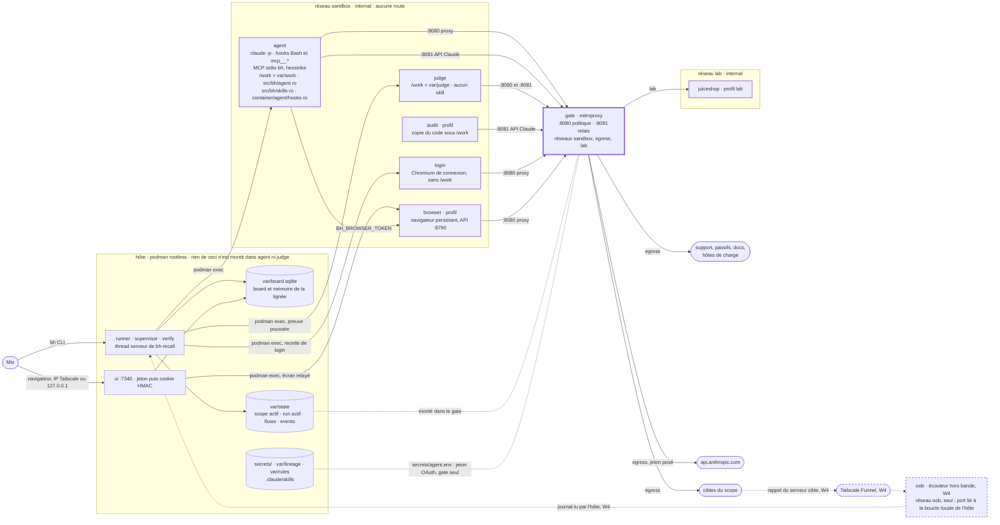
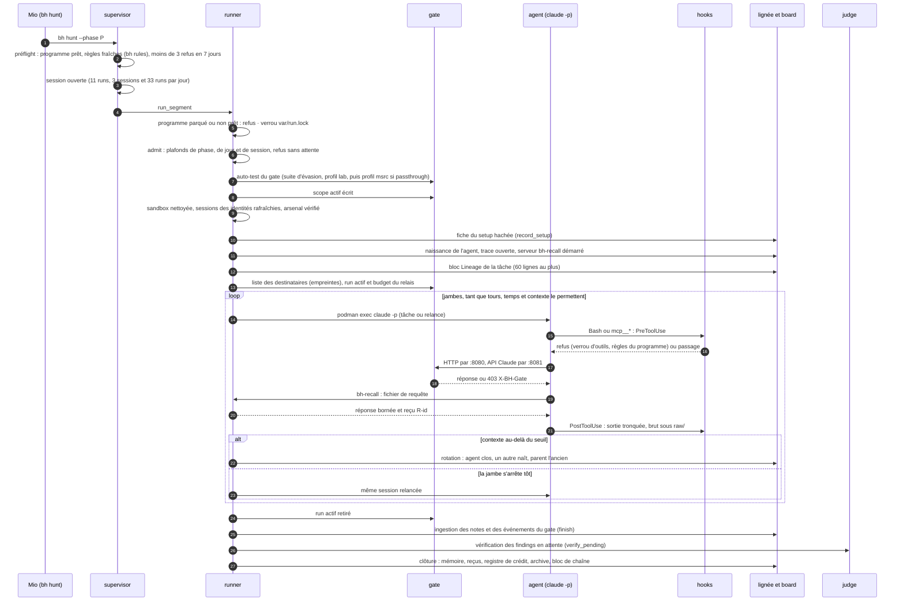
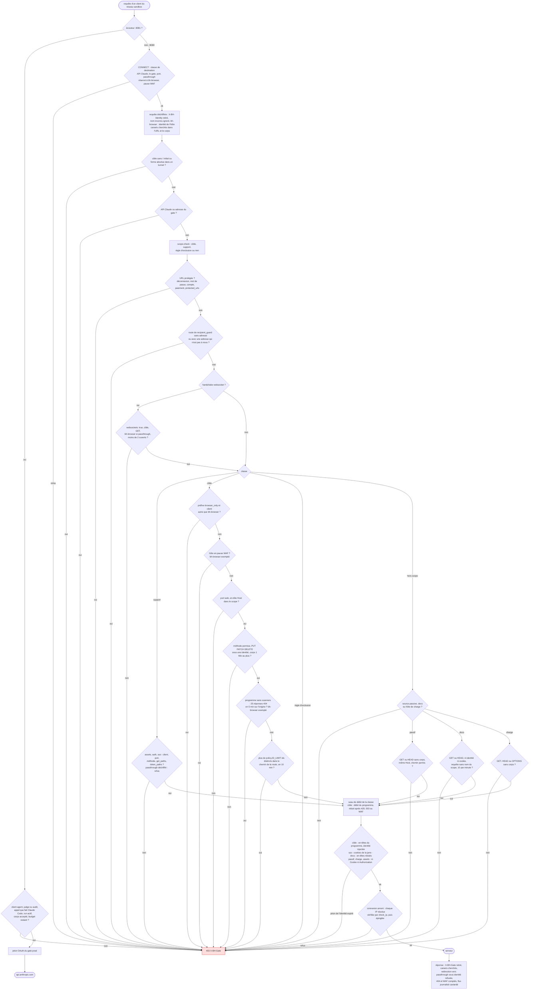
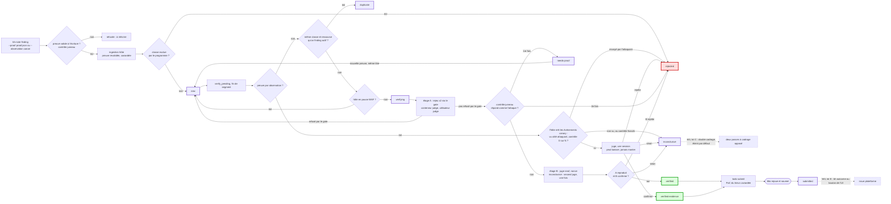
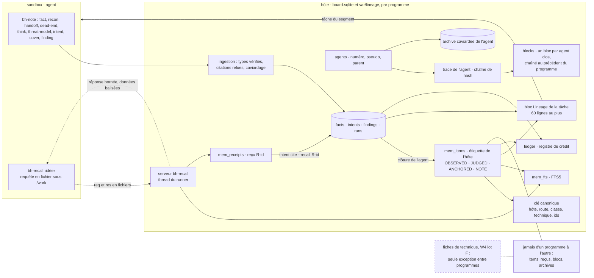

# Schémas d'architecture

Redessinés en W4 (lot G) depuis le code à `b160269` (W1 à W3 fusionnées). Cinq schémas, rien d'autre : chaque boîte et
chaque flèche renvoie à un `fichier:ligne` cité sous le schéma. Ce qui n'existe pas encore dans le dépôt porte la
mention « W4 » et un trait pointillé. `tests/test_w4_docs.py` vérifie que les chemins, les services et les statuts cités
existent.

## 1. Runtime : qui parle à qui

L'agent n'a qu'une sortie : le gate, seul conteneur sur `egress`. Il voit son `/work`, le code de la sandbox, les skills
et les hooks, en lecture seule sauf `/work` ; jamais `secrets/`, `var/state`, `var/lineage`, `var/rules`,
`.claude/skills` ni le board. L'écouteur hors bande (W4) reçoit les rappels d'un serveur cible, jamais l'agent.

Sources :
- réseaux et services : `container/compose.yaml:29-36` (`sandbox` et `lab` internes), `:43-76` (gate, ses montages
  `:64-68`, `secrets/agent.env` `:59-60`, réseaux `:69`), `:78-114` (agent : `/work` `:100`, `src/bh/agent` `:105`,
  skills `:110`, hooks `:102`, réseau `:113`, `BH_BROWSER_URL` `:97`), `:120-139` (judge, `var/judge` `:133`),
  `:144-165` (audit), `:173-194` (login), `:204-236` (browser), `:239-246` (juiceshop) ;
- proxy et relais : `container/compose.yaml:11-27` (`HTTP_PROXY`, `ANTHROPIC_BASE_URL`), `:51-54` ;
  `src/bh/gate/addon.py:838-883` (relais, rôles agent, judge, audit) ;
- seule variable venue de `secrets/` dans agent et browser : `BH_BROWSER_TOKEN`, clé de l'API étroite de bh-browser
  (`container/compose.yaml:90-92`, `:215-217`) ; `.claude` n'est monté nulle part (`tests/test_w1_docs.py`) ;
- `var/lineage` et `lab/` jamais montés : `container/compose.yaml:6-7` ; `var/rules` : `src/bh/rules.py:1-6` ;
- hôte : `src/bh/paths.py:66-67` (board), `src/bh/ui/server.py:1-5` et `:795` (UI), `src/bh/lineage/serve.py:1-11`
  (bh-recall par fichiers), `src/bh/runner/run.py:2655-2668` (`podman exec` du chasseur) ;
- W4, lot A : service `oob`, écouteur lié à la boucle locale, publié par Tailscale Funnel (brief W4-G, item 1).

## 2. Un segment, en séquence

Du `bh hunt --phase` à la clôture. Les plafonds et les règles refusent avant tout : rien n'attend un humain. Le
`bh-recall` de l'agent est servi par un thread du runner, par fichiers, pendant toute la durée du segment.

Sources :
- `bh hunt` : `src/bh/cli.py:1204` (`--phase`), `src/bh/runner/supervisor.py:241-262` (préflight : `check_automation`,
  `rules_fresh` `:224-238`, refus en 7 jours), `:275-303` (session), `:46-49` (plafonds), `:128-150` (`admit`) ;
- segment : `src/bh/runner/run.py:2431-2494` (`run_segment` : `check_automation` `:2459`, `run_lock` `:2468`,
  `admit` `:2469`, auto-test `:2470-2476`), `src/bh/runner/preflight.py:1-16` (suite d'évasion, profils) ;
- `_run_locked` : `src/bh/runner/run.py:2523` (scope actif), `:2540-2550` (sandbox, identités, arsenal),
  `:2584-2597` (setup haché), `:2599` (naissance), `:2602` (bloc), `:2619` (destinataires), `:2637` (run actif et
  budget), `:2645-2793` (jambes, rotation `:2742-2779`, relance `:2780-2785`), `:2816` (run actif retiré), `:2835`
  (`finish`), `:2840-2856` (vérification), `:2861` (clôture) ;
- hooks : `container/agent/hooks/settings.json` (PreToolUse et PostToolUse sur `Bash` et `mcp__.*`) ;
- lignée : `src/bh/runner/lineage_hooks.py:97-139` (naissance, trace, serveur), `:173-180` (rotation), `:194-237`
  (clôture) ; `src/bh/lineage/serve.py:82-116` ; `src/bh/agent/recall.py:1-13` ;
- ingestion : `src/bh/runner/run.py:1505-1517`, `src/bh/runner/ingest.py:131`, `:601`.

## 3. Décision du gate pour une requête

L'ordre est celui du code : `addon.request` puis `Policy.classify_request` puis `Policy._classify`, enfin le seau de
débit et l'injection. Le premier refus répond `403` avec `X-BH-Gate` et une raison ; rien d'autre ne part.

Sources :
- relais : `src/bh/gate/addon.py:896-902`, `:838-883` ; `src/bh/gate/policy.py:1215` (`check_relay`) ;
- CONNECT : `src/bh/gate/addon.py:657-676`, `src/bh/gate/policy.py:343-370` (`classify_connect`) ;
- requête : `src/bh/gate/addon.py:903-950` (identité `:904-920`, canaris `:921-922`, `/` initial `:923-925`, forme
  absolue `:930-932`, appel `:936`) ;
- `classify_request` : `src/bh/gate/policy.py:399-448` (API Claude et gate `:421-424`, scope `:425` et `:315-327`,
  URL protégées `:426-427` et `:116-121`, destinataires `:428-432` et `:372-397`) ;
- `_classify` : `src/bh/gate/policy.py:450-516` (websocket `:465-475`, support `:476-479` et `:539-583`, cible
  `:480-498` : `browser_only` `:481-482`, pause WAF `:483-484` et `:701-715`, port `:485-486`, Host `:487-490`, méthode
  et identité `:491-494`, corps `:495-496`, garde 404 `:497` et `:603-616`, énumération `:498` et `:618-649`,
  `ID_LIMIT` `:112`), exclusion `:499-500`, passif `:501-509`, docs `:510-513` et `:518-537`, charge `:514-515` et
  `:883`, refus final `:516` ;
- débit et injection : `src/bh/gate/addon.py:957-992`, `src/bh/gate/policy.py:675-728`, refus du jeton
  `src/bh/gate/addon.py:1039-1064` ;
- IP : `src/bh/gate/addon.py:797-831`, `src/bh/gate/policy.py:651-672` ;
- réponse : `src/bh/gate/addon.py:1146-1207`.

## 4. Cycle de vie d'un finding

Les neuf boîtes rouges, vertes et grises sont les statuts de `FINDING_STATUS`, et rien d'autre. Seuls `verified` et
`verified-evidence` ouvrent la todo `submit` ; Mio soumet. Le double cadrage et l'issue plateforme sont de W4.

Sources :
- statuts : `src/bh/board/db.py:135-146` (`FINDING_STATUS`) ;
- écriture et ingestion : `src/bh/agent/note.py` (`bh-note finding`), `src/bh/runner/ingest.py:240-253` (finding
  `new`, classe exclue `rejected`), `:195` (nouvelle preuve après `needs-proof`) ;
- vérification : `src/bh/verify.py:1-25` (table de décision), `:455-495` (`verify_finding` : observation `:464-465`,
  doublon `:472-475`, pause WAF `:479-482`, `verifying` `:483`), `:498-546` (`_verify` : étage A `:507`, refus du gate
  `:512-513`, `needs-proof` `:514-515` et `:279-298`, étage B `:517`, second juge `:519-533`, todo `submit` `:538-545`),
  `:227-237` (`decide`), `:263-276` (`_defer` : retour à `new`) ;
- observation : `src/bh/verify.py:579-588` (`decide_observation`), `:603-647`, `src/bh/runner/observation.py:75-135`
  (envoyé par l'attaquant : `rejected` ; contrôle franchi : `inconclusive`), `:166` ;
- soumission : `src/bh/cli.py:388` (`bh finding --set submitted`), `src/bh/ui/server.py:702` ;
- W4, lot C : double cadrage (`BH_DOUBLE_FRAMING=1`, défaut 0) ; W4, lot E : `bh outcome`.

## 5. Lignée et mémoire

Chaque session `claude -p` est un agent numéroté qui laisse des items typés à ses successeurs. L'étiquette vient de
l'hôte, jamais du texte de l'agent ; toute requête filtre par programme : rien ne traverse les programmes, sauf les
fiches de technique (W4).

Sources :
- notes typées : `src/bh/agent/contract.py:171-182` (`FACT_KINDS`, `INTENT_KINDS`), `src/bh/agent/note.py` ;
- ingestion : `src/bh/runner/ingest.py:131` (`notes`), `src/bh/runner/lineage_hooks.py:194-237` (clôture : mémoire
  `:208`, reçus `:209`, score `:210`, archive `:211-222`, bloc `:231`, identité `:232`) ;
- mémoire : `src/bh/lineage/store.py:1-20` (tables, règles, « every query filters by program »), `:71` (FTS5), `:77`
  (`LABELS`), `:678` (`ingest_run`) ; clé : `src/bh/lineage/key.py:1-7`, `:76` (`canonical`) ;
- rappel : `src/bh/agent/recall.py:1-13`, `src/bh/lineage/serve.py:1-11`, `src/bh/lineage/recall.py:1-20`, `:277`
  (filtre `m.program=?`), `:372` (`search`), `:680` (`mark_intents`) ;
- bloc : `src/bh/lineage/block.py:1-14`, `:333` (`build`) ; agents : `src/bh/lineage/identity.py:83` (`birth`), `:122`
  (`close`) ; chaîne : `src/bh/lineage/chain.py:1-12`, `:73`, `:147` ; registre : `src/bh/lineage/score.py:1-12`,
  `:79`, `:436` ; archive : `src/bh/lineage/archive.py:1-9` ;
- W4, lot F : fiches de technique, seules partagées entre programmes (brief W4-G, item 5).
