# Diagrammes d'architecture

Sources mermaid de la revue du 2026-11-24 (skill `improve-codebase-architecture`).
Page rendue : artifact « bull-harness architecture ». Les schémas des outils tiers sont reconstruits
depuis leur arborescence et leur README (lecture GitHub du 2026-11-24).

## Runtime · qui parle à qui

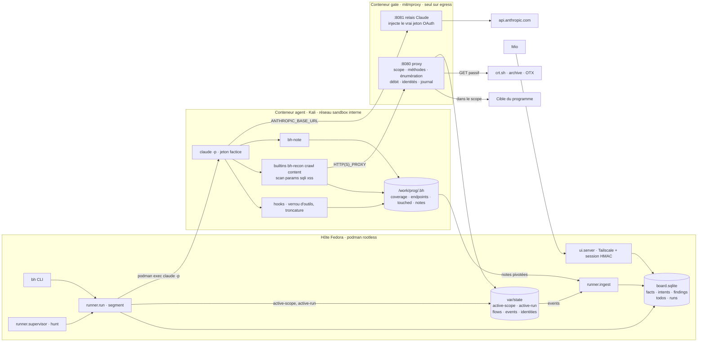

## Un segment · séquence

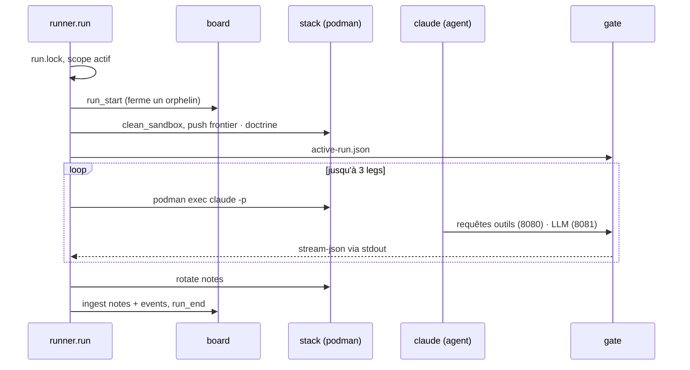

## Décision du gate · une requête

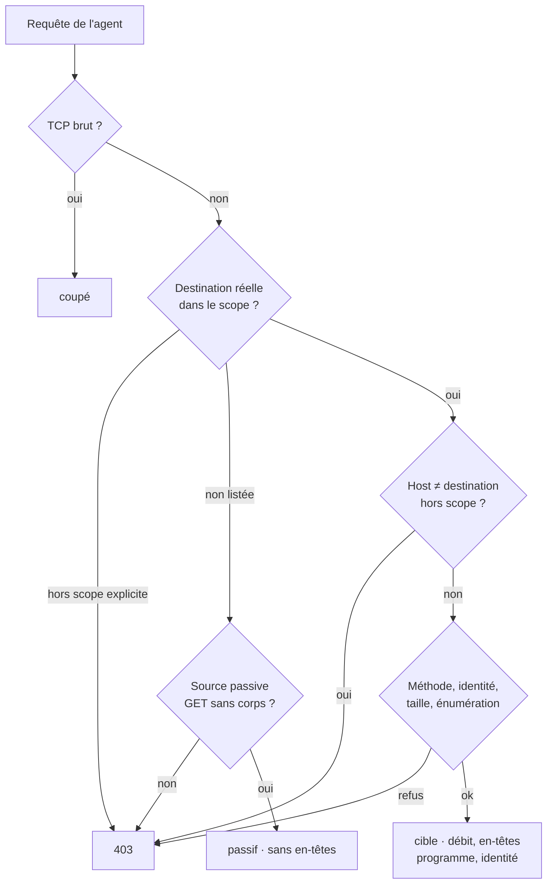

## Carte des modules · imports Python

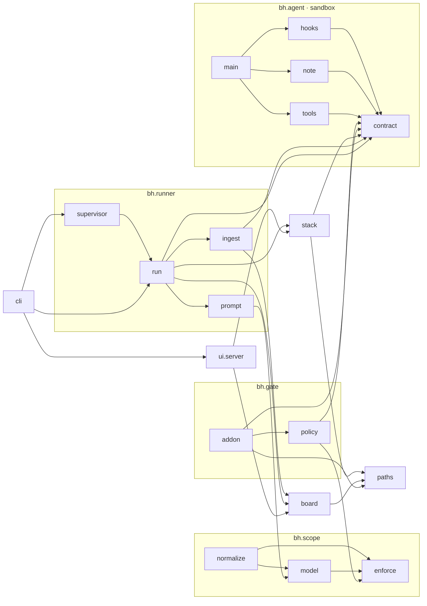

## Avant

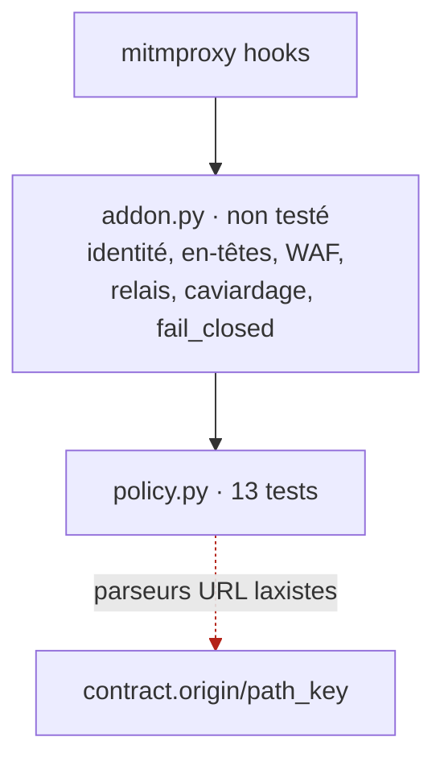

## Après

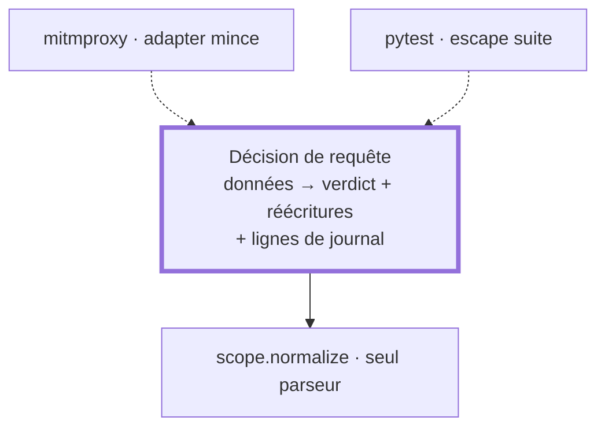

## Avant

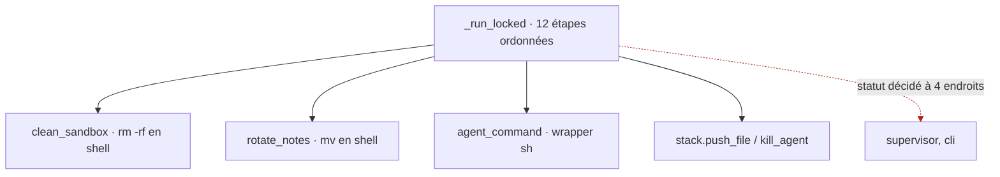

## Après

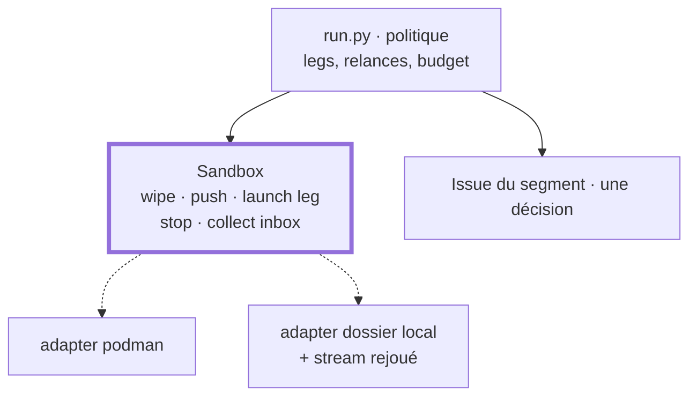

## Avant · « testé » vient de 7 endroits

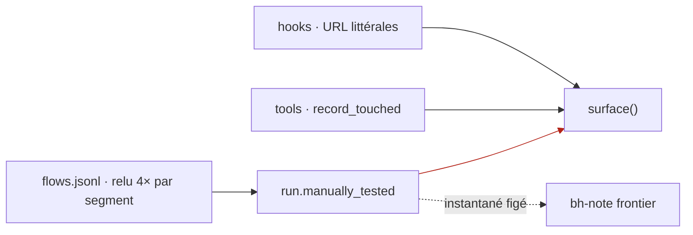

## Après

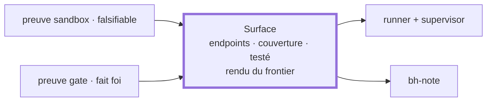

## Avant

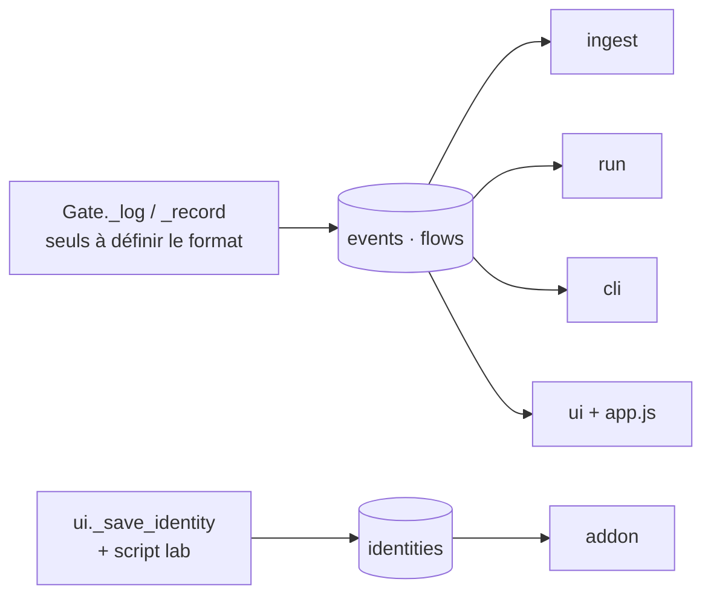

## Après

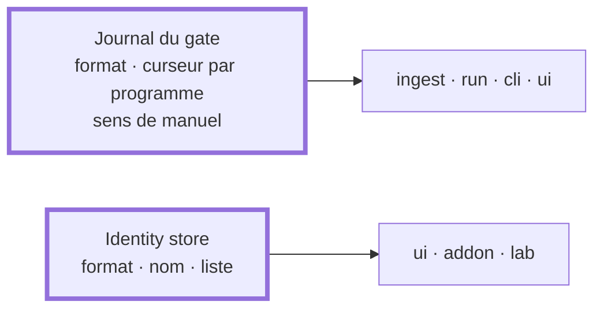

## bull-harness

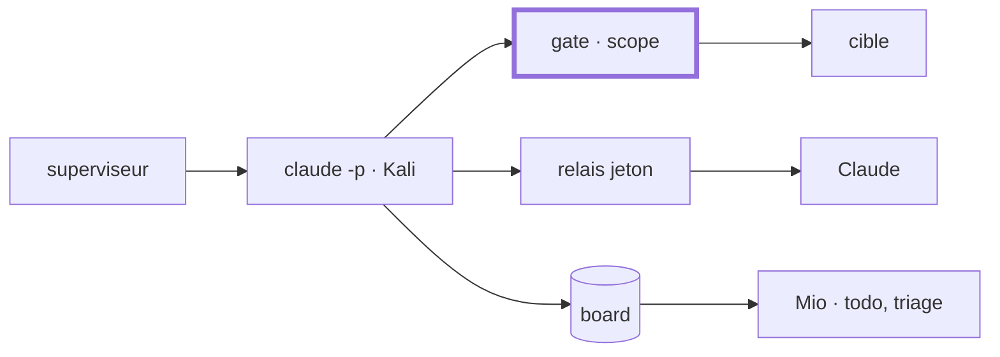

## PentAGI

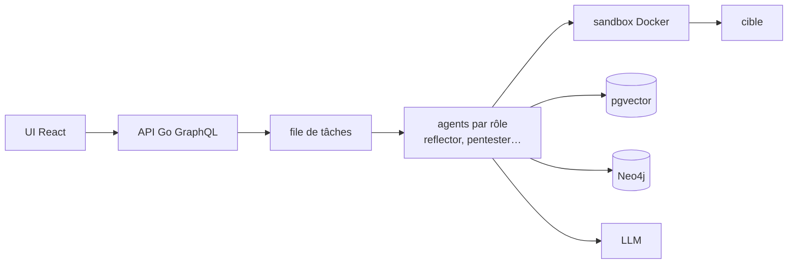

## ARTEX

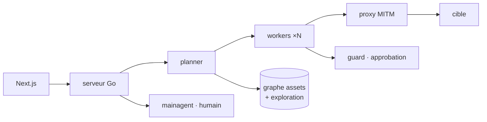

## HexStrike AI

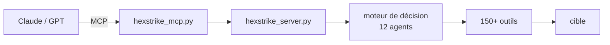

## CyberStrikeAI

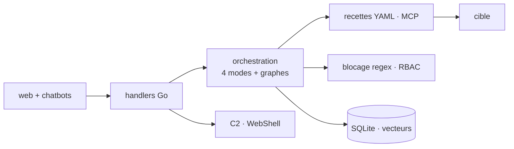

## Cairn

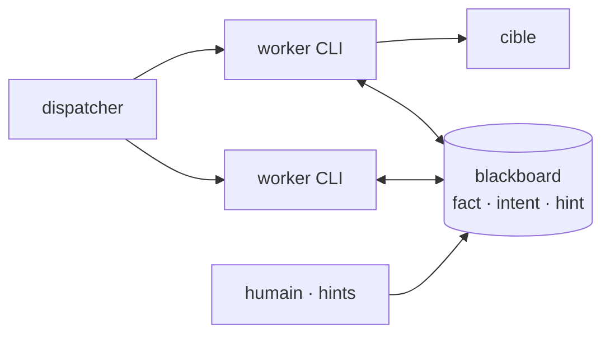

## sapper-v2

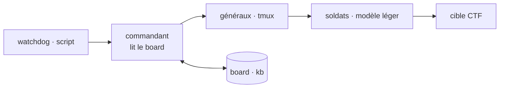

## Claude-BugHunter

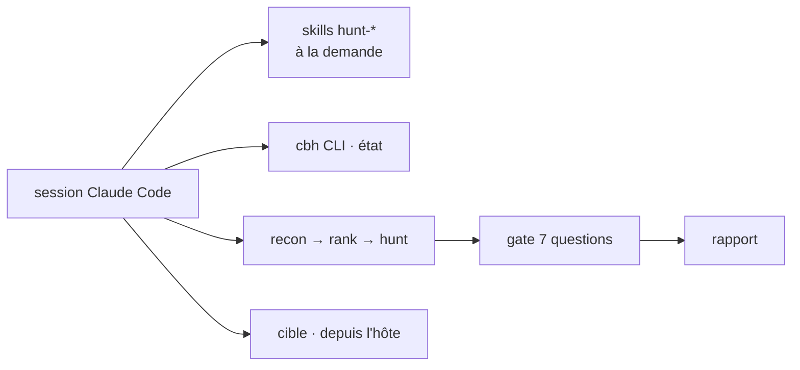

## bugbounty-lab101

```mermaid
flowchart LR
  SH["bugbounty-hunter.sh"] --> PR["programs/*.md"]
  SH --> SG["scope_guard.py"]
  SG --> SC["scripts · auto-scanner"] --> T["cible"]
  SC --> MV["vérif manuelle"] --> DD["duplicate_check"]
    
```
