# Diagrammes d'architecture

État du 2026-11-24, après la revue hostile (Mythos 5.2) et ses correctifs. Chaque bloc est du mermaid
rendu par GitHub. La dernière partie compare bull-harness aux outils étudiés avant de le construire.

## 1. Runtime · qui parle à qui

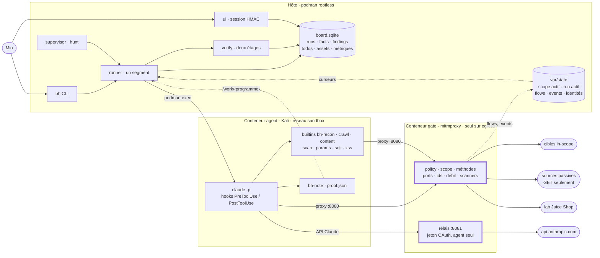

## 2. Un segment · séquence

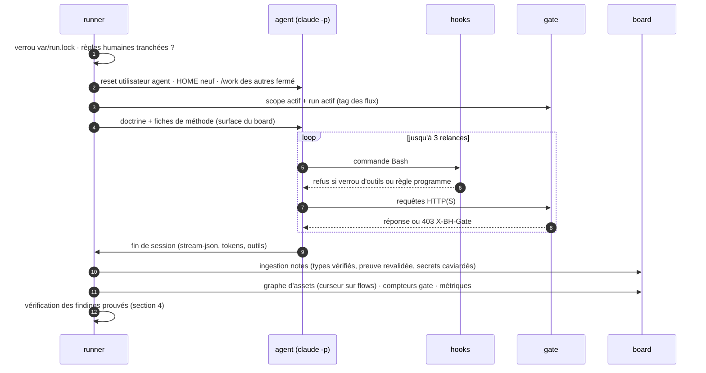

## 3. Décision du gate · une requête

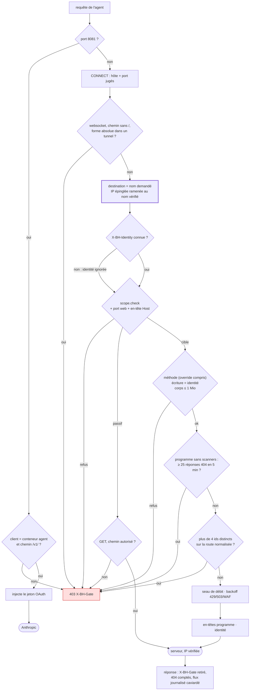

## 4. Cycle de vie d'un finding

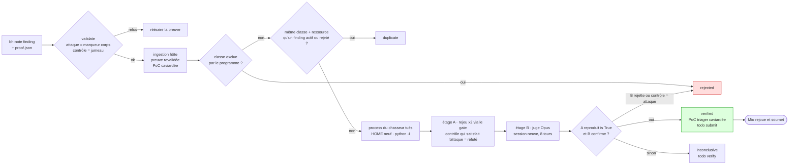

## 5. Règles d'un programme · de YesWeHack au gate

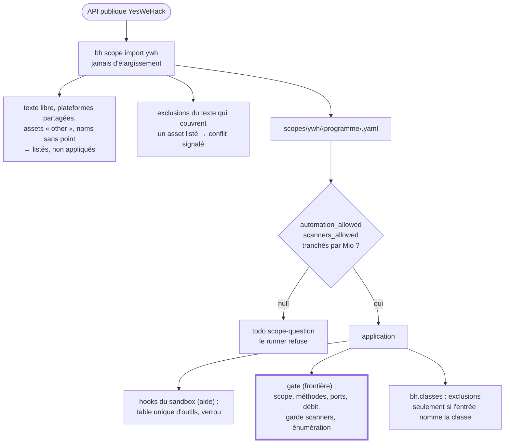

## 6. Carte des modules · imports Python

Calculée depuis le code (`ast`, imports `bh.*`). Le code du sandbox (`bh.agent`) n'importe que la
bibliothèque standard ; le gate n'importe ni le runner ni le board.

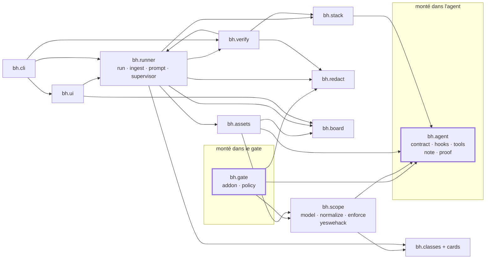

`runner ↔ verify` est le seul cycle : le vérificateur réutilise `agent_command`, `run_leg` et
`clean_sandbox` du runner, et le runner appelle `verify_pending` en fin de segment (import paresseux).

# Comparaison avec les outils étudiés

Schémas reconstruits depuis l'arborescence et le README de chaque outil (lecture GitHub du 2026-11-24).

## bull-harness

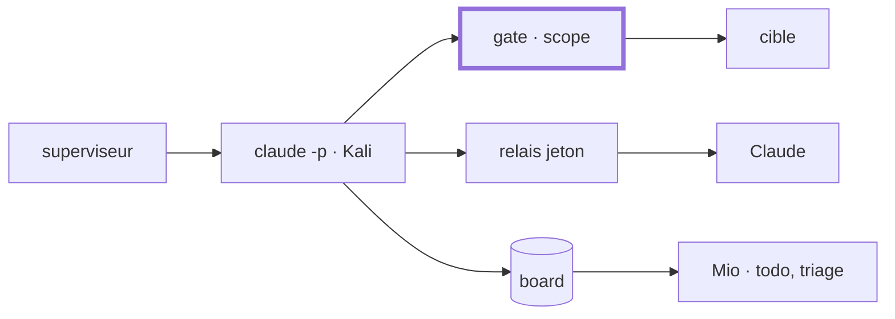

## PentAGI

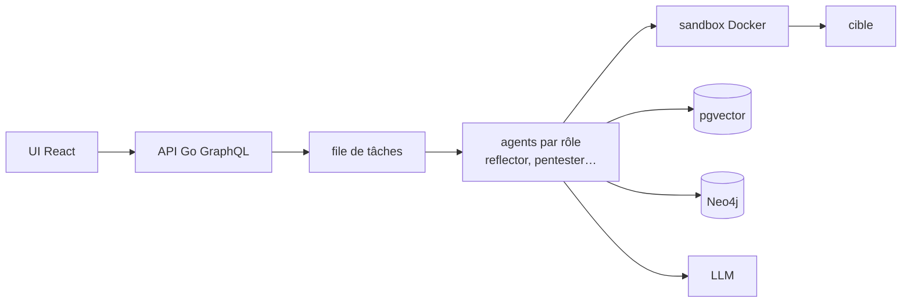

## ARTEX

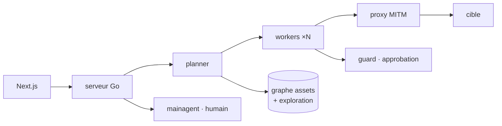

## HexStrike AI

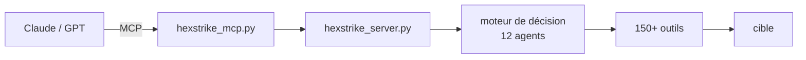

## CyberStrikeAI

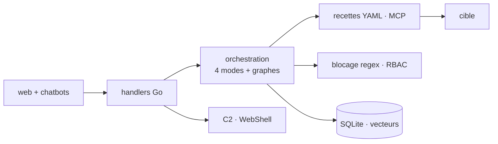

## Cairn

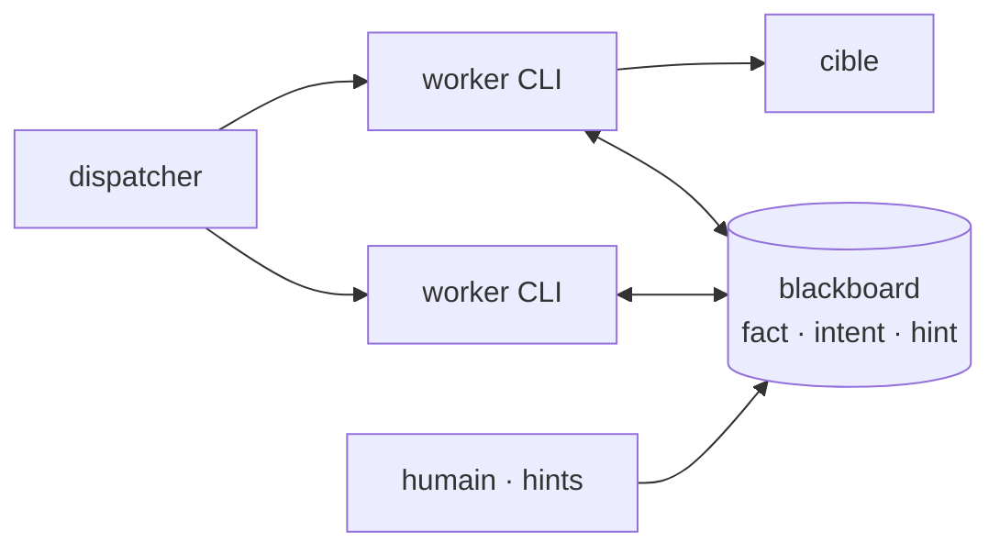

## sapper-v2

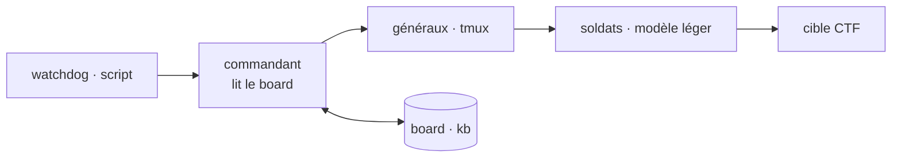

## Claude-BugHunter

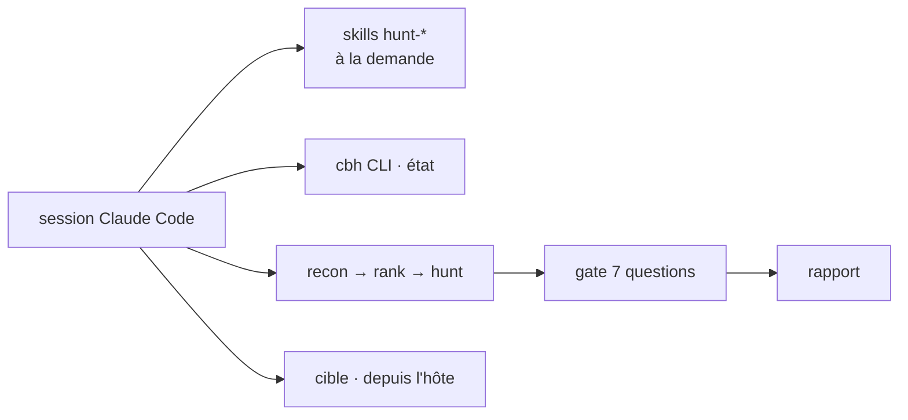

## bugbounty-lab101

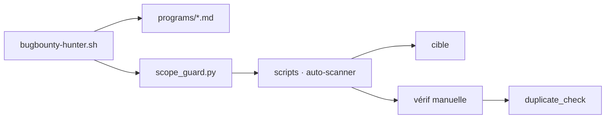
